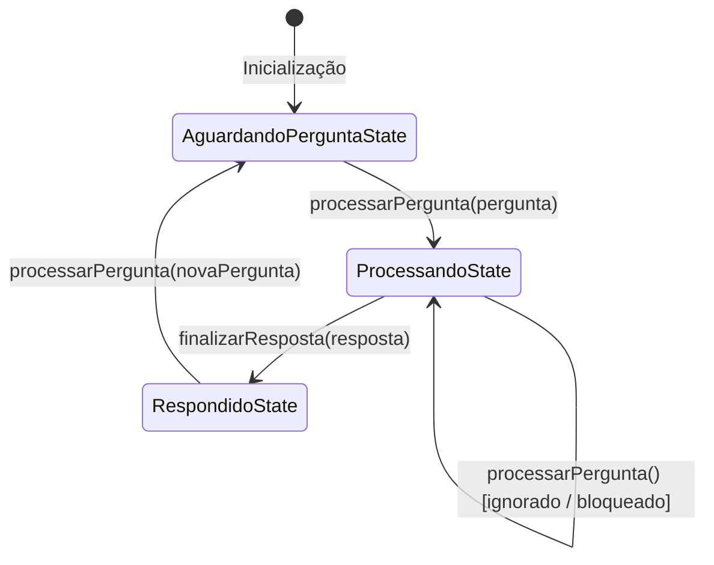
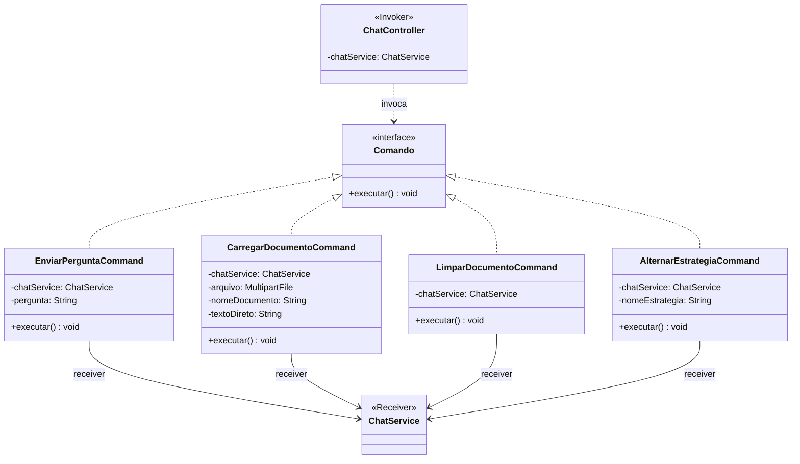
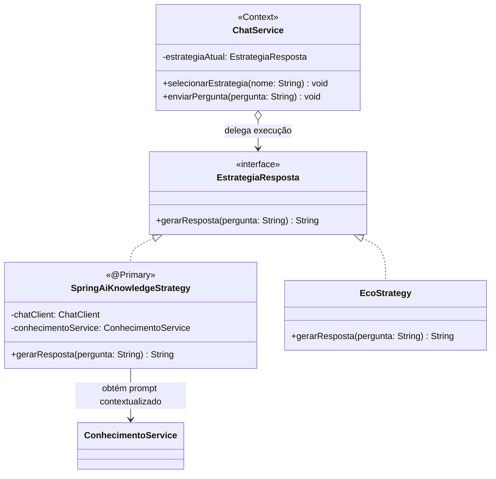
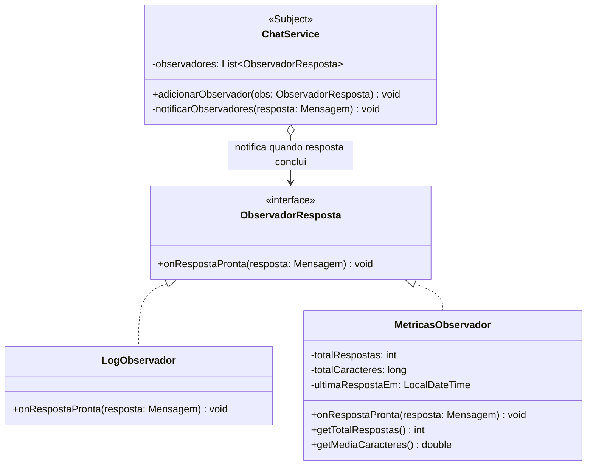
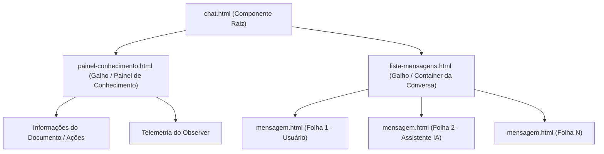

# Diagramas UML da Arquitetura - IAbertoti

Este diretório contém os diagramas de arquitetura e modelagem formal dos **5 Padrões de Projeto (GoF)** exigidos na disciplina de Engenharia de Software III (Prof. Bertoti).

Os diagramas estão disponíveis tanto no formato nativo **PlantUML (`.puml`)** para edição e renderização com a ferramenta oficial, quanto em **Mermaid**, renderizado automaticamente pela interface do GitHub.

---

## 1. Visão Geral da Arquitetura

Arquivo PlantUML: [`arquitetura-geral.puml`](./arquitetura-geral.puml)

```mermaid
flowchart TD
    subgraph GUI ["GUI (Composite)"]
        ChatHTML["chat.html (Raiz)"]
        PainelHTML["painel-conhecimento.html (Galho)"]
        ListaHTML["lista-mensagens.html (Galho)"]
        MsgHTML["mensagem.html (Folha)"]
        ChatHTML --> PainelHTML
        ChatHTML --> ListaHTML
        ListaHTML --> MsgHTML
    end

    subgraph Controller ["Camada Web MVC"]
        ChatController["ChatController\n(Invoker do Command)"]
    end

    subgraph Commands ["Padrão Command"]
        Comando["<<interface>>\nComando"]
        CmdPergunta["EnviarPerguntaCommand"]
        CmdDoc["CarregarDocumentoCommand"]
        CmdLimpar["LimparDocumentoCommand"]
        CmdEstrategia["AlternarEstrategiaCommand"]
        Comando <|.. CmdPergunta
        Comando <|.. CmdDoc
        Comando <|.. CmdLimpar
        Comando <|.. CmdEstrategia
    end

    subgraph Service ["Camada de Serviços & Orquestração"]
        ChatService["ChatService\n(Context & Subject)"]
        ConhecimentoService["ConhecimentoService\n(Gestão de RAG)"]
    end

    subgraph StatePattern ["Padrão State (Ciclo de Vida)"]
        SessaoChat["SessaoChat (Context)"]
        EstadoSessao["<<interface>>\nEstadoSessao"]
        AguardandoState["AguardandoPerguntaState"]
        ProcessandoState["ProcessandoState"]
        RespondidoState["RespondidoState"]
        SessaoChat --> EstadoSessao
        EstadoSessao <|.. AguardandoState
        EstadoSessao <|.. ProcessandoState
        EstadoSessao <|.. RespondidoState
    end

    subgraph StrategyPattern ["Padrão Strategy (Geração de Resposta)"]
        EstrategiaResposta["<<interface>>\nEstrategiaResposta"]
        SpringAiStrat["SpringAiKnowledgeStrategy\n(@Primary)"]
        EcoStrat["EcoStrategy\n(Mock / Dev)"]
        EstrategiaResposta <|.. SpringAiStrat
        EstrategiaResposta <|.. EcoStrat
    end

    subgraph ObserverPattern ["Padrão Observer (Eventos)"]
        ObservadorResposta["<<interface>>\nObservadorResposta"]
        LogObs["LogObservador"]
        MetricasObs["MetricasObservador"]
        ObservadorResposta <|.. LogObs
        ObservadorResposta <|.. MetricasObs
    end

    subgraph LLM ["Spring AI + Modelo Aberto"]
        ChatClient["ChatClient"]
        OllamaLocal["Ollama Server (Local:11434)\nModelo: llama3.1 / llama3.2"]
        ChatClient --> OllamaLocal
    end

    GUI -->|HTTP POST| ChatController
    ChatController -->|instancia e executa| Commands
    Commands -->|chama lógica no receiver| ChatService
    ChatService -->|controla ciclo| SessaoChat
    ChatService -->|delega resposta| StrategyPattern
    ChatService -->|notifica resposta| ObserverPattern
    ChatService -->|gerencia base| ConhecimentoService
    SpringAiStrat -->|injeta contexto do documento| ConhecimentoService
    SpringAiStrat -->|invoca inferência| ChatClient
```

---

## 2. Padrão State

Arquivo PlantUML: [`state.puml`](./state.puml)

### Diagrama de Estados (Ciclo de Vida da Sessão):


---

## 3. Padrão Command

Arquivo PlantUML: [`command.puml`](./command.puml)



---

## 4. Padrão Strategy

Arquivo PlantUML: [`strategy.puml`](./strategy.puml)



---

## 5. Padrão Observer

Arquivo PlantUML: [`observer.puml`](./observer.puml)



---

## 6. Padrão Composite (GUI Thymeleaf)

Arquivo PlantUML: [`composite.puml`](./composite.puml)


